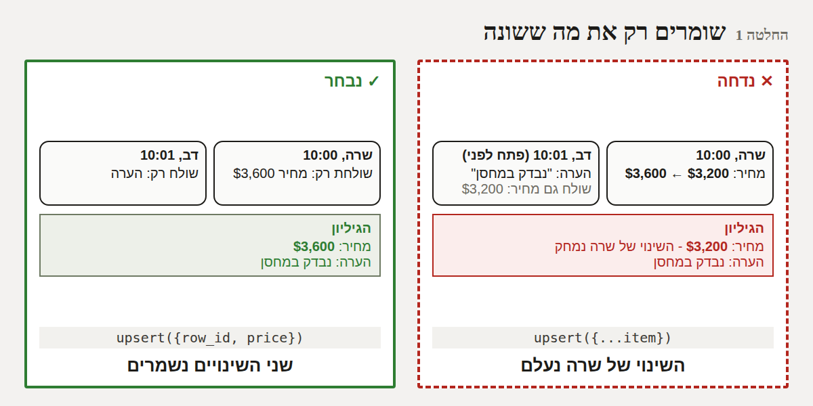
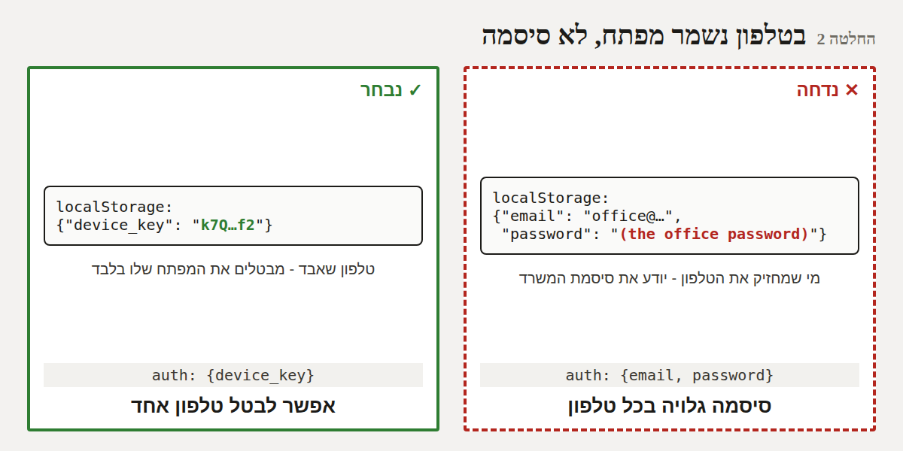
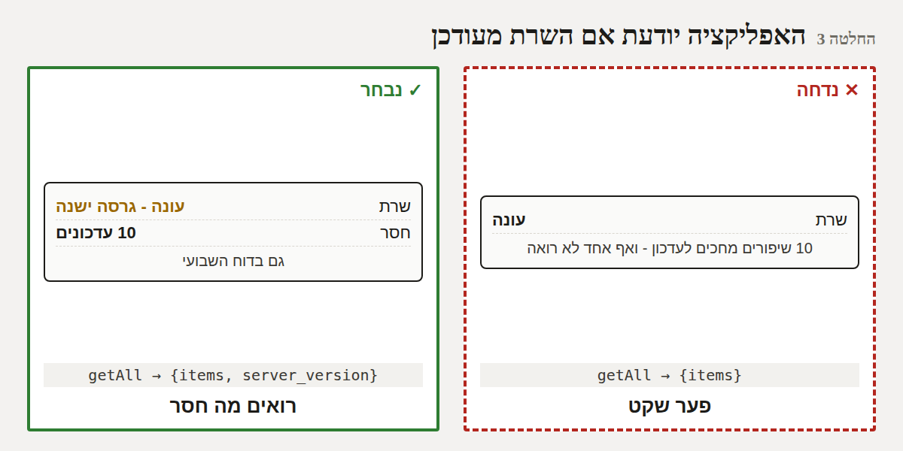
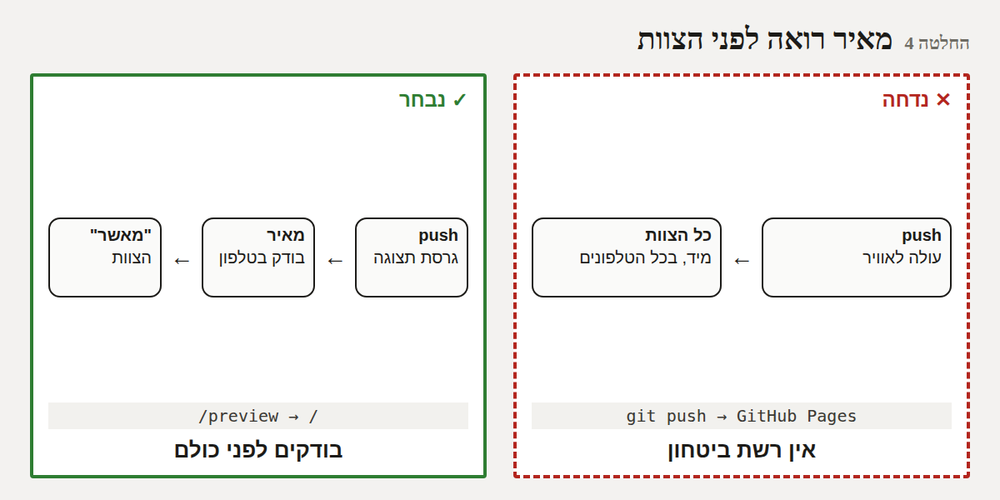
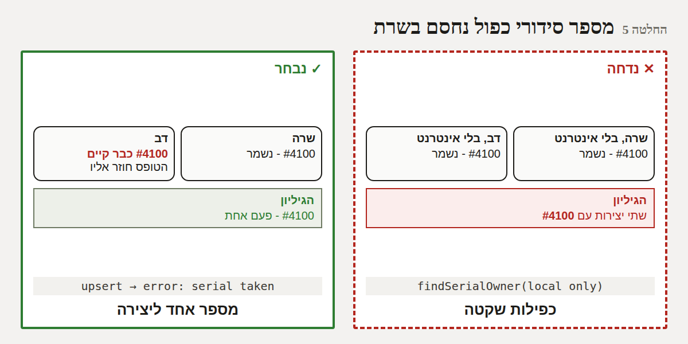

# סקירה לאחור בשיטת DDD: כל האפליקציה - ארכיטקטורה, חוויית משתמש וערך

*21/10/2026. סקירה, לא בנייה - שום דבר מכאן לא משתנה בלי "מאשר". השיטה: `docs/ddd/README.md`.*

**מה נבדק:** 105 ההחלטות שהאפליקציה קיבלה מאז 07/09 (נאספו מכל האפיון, 1,713 שורות), 56 התקלות שנרשמו,
והקוד עצמו. כל טענה שאפשר היה לבדוק - **נמדדה או הודגמה** על האפליקציה ועל קוד השרת בסימולציה.

---

## 1. בשורה התחתונה

- **הבסיס נכון.** הבחירה המרכזית - עותק מלא בטלפון + גוגל שיטס כשרת חינמי - הוכחה במדידה: פתיחה ב-0.4
  שנייה, עובד בלי אינטרנט, ועומד ביעד של 1,000 יצירות.
- **5 החלטות כדאי לשנות** (סעיף 6), שתיים מהן חשובות באמת: **עריכה בו-זמנית מוחקת שינויים** (הודגם),
  ו**סיסמת המשרד שמורה גלויה בכל טלפון**.
- **צוואר הבקבוק הגדול הוא לא הקוד - אלא עדכון השרת הידני:** 10 שיפורים מחכים לו, וחלק מהפתרונות כאן
  נשענים עליו.
- **הערך - עוד לא נמדד באמת.** המטרה העיקרית של האפליקציה ("השלמה הדרגתית של מחירים ומספרים חסרים")
  תימדד לראשונה בדוח השבועי, אחרי עדכון השרת.

## 2. הערך - מה האפליקציה הבטיחה, ומה ידוע היום

| המטרה (מתוך האפיון) | מה ידוע | איך נמדד |
|------|------|------|
| לחפש ולצפות **במהירות** | ✅ פתיחה 0.4 שנ' (פעם ראשונה ברשת איטית: 4.1 שנ') | נמדד היום, 147 יצירות |
| **מכל מכשיר, גם בלי אינטרנט** | ✅ בלי אינטרנט: הקטלוג מוצג תוך 0.17 שנ' | נמדד היום |
| עדכון של אחד **מגיע לכולם** | ⚠️ מגיע - אבל שתי עריכות קרובות מוחקות אחת את השנייה | הודגם (סעיף 5) |
| עד 1,000 יצירות | ✅ סנכרון של 1,000: כ-18KB דחוס; 5,000: כ-87KB | נמדד בסימולציה |
| **השלמה הדרגתית של נתונים חסרים** - "מטרה חשובה נוספת" | ❓ לא ידוע. אין היום שום מספר על כמה יצירות עדיין בלי מחיר / מספר | הדוח השבועי (בריאות הקטלוג) - **אחרי עדכון השרת** |
| *(נוסף בדרך)* שיתוף ללקוחות | ✅ כרטיס מעוצב; ⚠️ לא נבדק עדיין באייפון אמיתי | OPEN_ITEMS |
| האם הצוות **משתמש** בזה | ❓ לא ידוע | לופ השיפור - אחרי עדכון השרת |

**מסקנה:** האפליקציה בנתה הרבה יכולת, אבל עוד לא מוכיחה ערך. ההמלצה (החלטה 7 למטה): לקבוע **3 מדדי ערך**
ל-Goals, ולבדוק אותם כל שבוע.

## 3. הדמויות והוויכוח

הדמויות הקבועות (`docs/ddd/README.md`): שרה, דב, יוסי, הלקוח, מאיר, "האייפון", "גוגל", בודקת הנגישות.

**סבב 1 - האם הבסיס נכון?**
- *"גוגל":* "אני חינמי, אבל כל שינוי בי - מאיר מעדכן ביד. ויש לי מגבלות שאי אפשר לבדוק מראש."
- *מאיר:* "שרת אמיתי עולה כסף וצריך מישהו שיתחזק אותו. לגלריה עם 6 אנשים זה לא שווה."
- *הסימולציה:* פתיחה 0.4 שנ', בלי אינטרנט 0.17 שנ', 1,000 יצירות - 18KB לסנכרון. **הבסיס עומד.**
- *"האייפון":* "רוב התקלות שלי היו 'ברקע' - וזה כבר מטופל כעיקרון (סעיף 30)."

**סבב 2 - שני אנשים עורכים את אותה יצירה.**
- *שרה:* "עדכנתי מחיר ל-$3,600. דקה אחר כך דב שמר הערה על אותה יצירה - והמחיר חזר ל-$3,200. אף אחד לא ראה."
- *הסימולציה:* **שוחזר בדיוק כך** על קוד השרת. וגם: יצירה שנמחקה **חוזרת** כשמישהו שמר טופס שהיה פתוח אצלו.
- *דב:* "ואם אני עורך בלי אינטרנט בבוקר, ומסנכרן בצהריים - אני מוחק את מה שאחרים עשו בינתיים."
- *ממצא:* קוד השרת החדש (שמחכה לעדכון) **כבר יודע** לשמור רק את השדות שנשלחו. נשאר רק שהאפליקציה תשלח
  רק את מה ששונה - ובסימולציה שני השינויים נשמרים.

**סבב 3 - אבטחה.**
- *"האייפון":* "סיסמת המשרד שמורה אצלי **גלויה**, ונשלחת בכל בקשה. מי שמחזיק טלפון של עובד שעזב - יודע אותה."
- *מאיר:* "ואם עובד עוזב, אני צריך להחליף סיסמה לכולם."
- *"גוגל":* "וקוד האיפוס (6 ספרות, 15 דקות) - אין לי הגבלה על ניסיונות שגויים." *(נבדק בקוד - נכון.)*
- *יוסי:* "התמונות פתוחות לכל מי שיש לו קישור - זה בסדר, הן ממילא באינסטגרם."

**סבב 4 - מה שמחכה לעדכון השרת.**
- *מאיר:* "אני צריך לזכור לעדכן, ולא רואה מה חסר."
- *"גוגל":* "האפליקציה לא יודעת באיזו גרסה אני. היא מנחשת לפי 'האם הוא מכיר את הפעולה'."
- *בודקת הנגישות:* "ו-push עולה מיד לכל הצוות. אין שלב שבו מאיר רואה קודם."
- *שרה:* "מספר סידורי כפול נבדק רק אצלי בטלפון. שתיים בלי אינטרנט יכולות לתת אותו מספר."

**סבב 5 - חוויית משתמש וערך.**
- *דב:* "האפליקציה ב-3 שפות. מי בצוות משתמש בדנית?" *(אין לזה סיבה כתובה באפיון. כל טקסט נכתב ×3.)*
- *הלקוח:* "יצירה בלי תמונה - אי אפשר לשלוח לי עליה כלום." *(לפני 28.1 אפשר היה לשלוח פרטים בטקסט.)*
- *יוסי:* "המטרה הייתה להשלים מחירים ומספרים חסרים. מישהו יודע אם זה קורה?" - *אף אחד, עדיין.*
- *מאיר:* "והאפיון עצמו - ההתחלה שלו עוד מתארת כניסה עם Gmail שהוסרה מזמן."

## 4. עץ ההחלטות של האפליקציה (תמצית)

```
קטלוג הגלריה
├── פלטפורמה: אפליקציית רשת מותקנת ✓  │ אפליקציה בחנות ✕ (עלות, אישורים)
├── שרת: גוגל שיטס + Apps Script ✓ (חינם)  │ שרת אמיתי ✕
│   ├── עדכון השרת: ידני ✓ היום  ← ⚠️ החלטה 3
│   └── גרסת השרת ידועה לאפליקציה? ✕ היום  ← ⚠️ החלטה 3
├── נתונים: עותק מלא בטלפון ✓ (נמדד)  │ רק אונליין ✕
│   ├── סנכרון: כל הקטלוג כל 45 שנ' ✓ (נמדד: עומד ב-1,000)
│   ├── התנגשות: השורה כולה, האחרון מנצח ✓ היום  ← ⚠️ החלטה 1 (רק מה ששונה)
│   └── מספר סידורי ייחודי: נבדק בטלפון בלבד  ← ⚠️ החלטה 5
├── כניסה: סיסמה משותפת ✓
│   └── נשמרת בטלפון: גלויה ✓ היום  ← ⚠️ החלטה 2 (מפתח מכשיר)
├── תמונות: דרייב, פתוח בקישור ✓ (נשאר - ממילא באינסטגרם)
├── שחרור: push = כל הצוות מיד ✓ היום  ← ⚠️ החלטה 4 (גרסת תצוגה למאיר)
├── ערך: לא נמדד  ← ⚠️ החלטה 7 (3 מדדי ערך)
└── האפיון עצמו: מתוקן בתוספות, ישן נשאר  ← ⚠️ החלטה 6 (ניקוי)
```

## 5. הסימולציה - מה נמדד

| תרחיש | תוצאה | איך |
|------|------|------|
| פתיחה ראשונה, רשת איטית | הקטלוג אחרי 4.1 שנ' | האפליקציה הבנויה, 147 יצירות, רשת מואטת |
| פתיחה שנייה | 0.44 שנ' | כנ"ל |
| פתיחה בלי אינטרנט | 0.17 שנ' | כנ"ל |
| גודל סנכרון: 147 / 1,000 / 5,000 יצירות | 68 / 462 / 2,325KB (דחוס: 3 / 18 / 87KB) | קוד השרת בסימולציה |
| **שרה משנה מחיר, דב שומר הערה מעותק ישן** | **המחיר של שרה נמחק** | קוד השרת בסימולציה |
| **יצירה נמחקה, טופס פתוח אצל אחר נשמר** | **היצירה חוזרת** | קוד השרת בסימולציה |
| אותו תרחיש, כששולחים רק את מה ששונה | שני השינויים נשמרים | קוד השרת **החדש** (מחכה לעדכון) |
| קוד איפוס סיסמה - ניסיונות שגויים | אין הגבלה | קריאת קוד השרת |
| מספר סידורי כפול - בשרת | לא נבדק בשרת | קריאת קוד השרת |
| 56 התקלות עד היום - מאיפה | 24 קשורות לשרת של גוגל, 19 לתמונות, 13 לסנכרון; **כ-23 נמצאו אצל אנשים אמיתיים** (לא בבדיקות) | TEST_PLAN |
| 10 שיפורים בצד השרת | מחכים לעדכון ידני מ-09/10 | OPEN_ITEMS |

## 6. ההחלטות המוצעות

### החלטה 1 - שומרים רק את מה ששונה ⚠️ חשוב
**החלטנו** שבשמירה האפליקציה תשלח לשרת רק את השדות שהשתנו (ומחיקה לא "תתבטל" משמירה של טופס ישן),
**כי** היום עריכה של אחד מוחקת שינוי של אחר בלי שאף אחד יידע (הודגם), והשרת החדש כבר תומך בזה. דורש את
עדכון השרת שממילא מתוכנן + שינוי קטן באפליקציה (רק מול שרת מעודכן).


### החלטה 2 - בטלפון נשמר מפתח, לא סיסמה ⚠️ חשוב
**החלטנו** שאחרי הכניסה הטלפון יקבל "מפתח מכשיר" ויישמר רק הוא - לא הסיסמה; ושקוד האיפוס ייחסם אחרי 5
ניסיונות שגויים, **כי** היום מי שמחזיק טלפון של עובד יודע את סיסמת המשרד, ועוזב מחייב החלפת סיסמה לכולם.
עם מפתח - מבטלים טלפון אחד. דורש עדכון שרת.


### החלטה 3 - האפליקציה יודעת אם השרת מעודכן
**החלטנו** שהשרת ידווח את הגרסה שלו, ו"מידע ותמיכה" + הדוח השבועי יראו "השרת בגרסה ישנה - חסרים N
עדכונים", **כי** היום 10 שיפורים מחכים והפער שקט. *(חלופה שנשקלה: עדכון שרת אוטומטי מ-GitHub - דורש לתת
ל-GitHub גישה לחשבון הגוגל של הגלריה. לא עכשיו.)*


### החלטה 4 - מאיר רואה לפני הצוות
**החלטנו** שלשינויים שרואים (כמו חבילה ב') תהיה "גרסת תצוגה" בכתובת נפרדת, שמאיר בודק בטלפון לפני שהיא
עוברת לצוות, **כי** היום push מגיע לכולם מיד, ויש תקלות שרק טלפון אמיתי מגלה (23 מתוך 56).


### החלטה 5 - מספר סידורי כפול נחסם גם בשרת
**החלטנו** שהשרת יסרב לשמור מספר סידורי שכבר קיים, והטופס יחזור לשדה עם ההודעה הרגילה, **כי** שני טלפונים
בלי אינטרנט יכולים היום לתת אותו מספר, והוא המזהה של היצירה. דורש עדכון שרת.


### החלטה 6 - ניקוי האפיון
**החלטנו** לכתוב מחדש את החלקים שהתיישנו באפיון (כניסה עם Gmail, "אין עדכון אוטומטי", "צור קוד", סעיף 23
שהוחלף ב-28, ועוד 4 סתירות), ולהעביר היסטוריה לנספח, **כי** האפיון הוא "מקור האמת" - וסתירות בו מטעות
כל מי שקורא אותו, כולל אותי בשיחה הבאה. בלי שינוי באפליקציה.

### החלטה 7 - 3 מדדי ערך, כל שבוע
**החלטנו** לרשום ב-Goals שלושה מדדים שאומרים אם האפליקציה שווה את זה: **יצירות בלי מחיר**, **יצירות בלי
מספר סידורי** (המטרה המקורית - צריכים לרדת), ו**שיתופים בשבוע** (הערך החדש), **כי** היום אין שום מספר
שמראה ערך, והדוח השבועי כבר יודע לחשב אותם - אחרי עדכון השרת.

### מה **לא** משנים - ולמה (נבדק ונשאר)
- **גוגל שיטס כשרת** - חינמי, עומד ביעד (נמדד). שרת אמיתי לא מוצדק לגודל הגלריה.
- **סנכרון כל הקטלוג כל 45 שנ'** - 18KB גם ב-1,000 יצירות. לחזור לזה רק מעל 1,000.
- **תמונות פתוחות בקישור** - היצירות ממילא פומביות (אינסטגרם, קטלוג).
- **"מי אתה" בלי סיסמה אישית** - צוות קטן שסומך זה על זה; סיסמה לכל אחד מוסיפה חיכוך בלי תועלת אמיתית.
- **כל השאר** (כ-95 החלטות - חוויית משתמש, עיצוב, תהליך) - נבדקו, נשארים.

## 7. שאלות פתוחות למאיר (לא החלטות - צריך את דעתך)

1. **דנית** - מישהו משתמש? אם לא - להוריד חוסך תחזוקה (כל טקסט ×3).
2. **שיתוף יצירה בלי תמונה** - לאפשר כרטיס בלי תמונה (שם + לוגו)? או שזה נכון שאין מה לשתף?
3. **שאלות ישנות שעוד פתוחות:** השם באנגלית בכרטיס, השווי בפירוט, 7 שורות "לא זמין בקטלוג" מההעברה מאקסל.

## 8. מה צריך ממך

לאשר לפי מספרים - למשל "מאשר 1, 2, 5, 6, 7" - ולענות על השאלות בסעיף 7. ההמלצה שלי לסדר:
**6 עכשיו** (בלי סיכון), **1 + 2 + 3 + 5 יחד עם עדכון השרת** (פריסה אחת), **7 מיד אחרי**, **4 לפני חבילה ב'**.
כל החלטה מאושרת תקבל מסמך DDD משלה לפני שנבנה.
