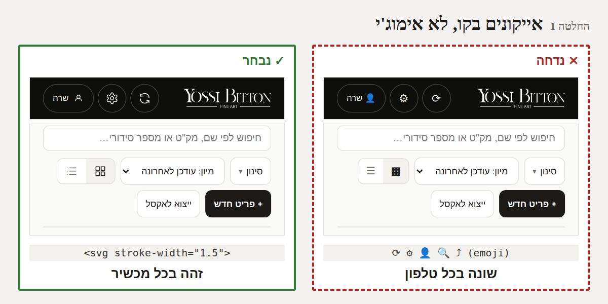
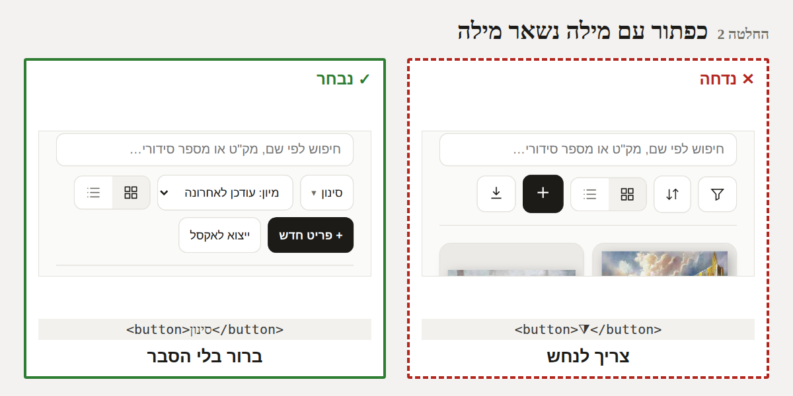
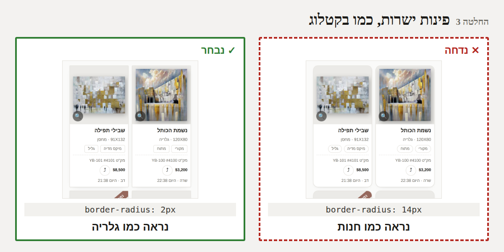
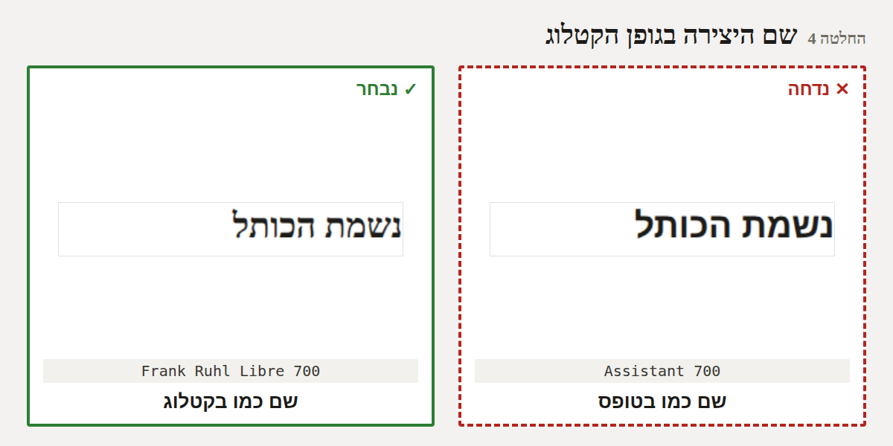
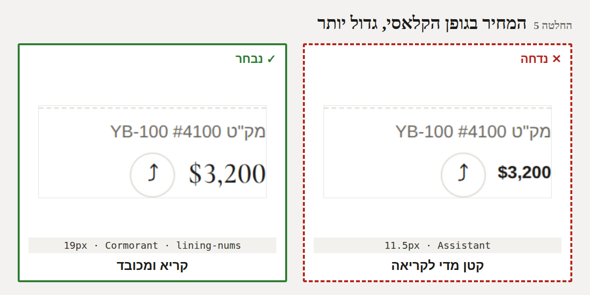
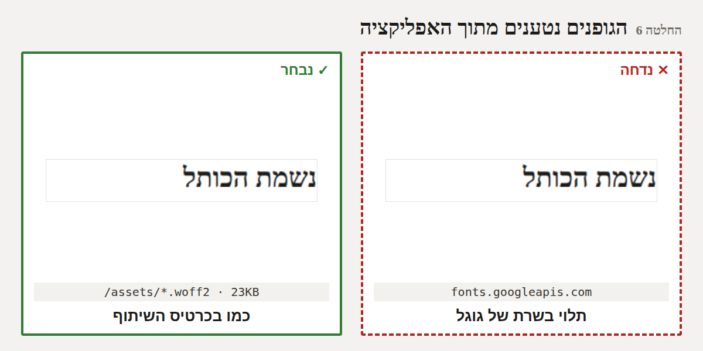
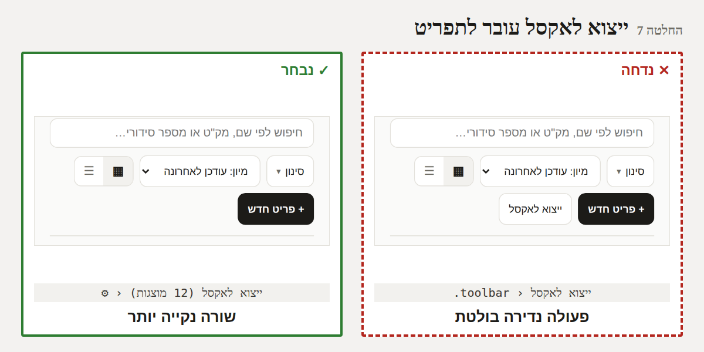
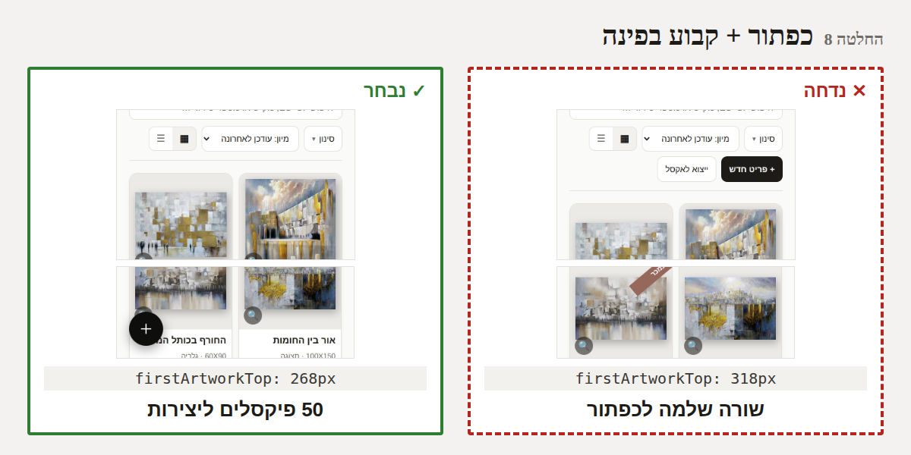
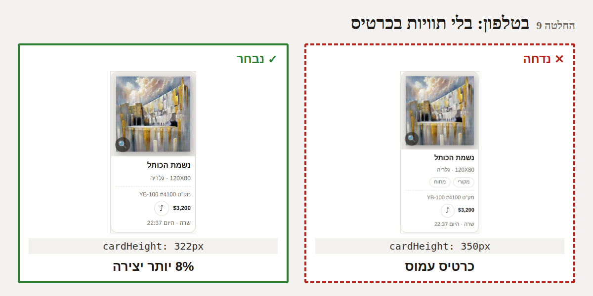

# חבילת עיצוב ב' - בשיטת Decision Driven Design

*21/10/2026. הצעה לאישור - שום דבר מכאן לא נבנה בלי "מאשר" (CLAUDE.md). מקור: `docs/DESIGN_REVIEW.md` המלצות 6-9.*

**איך זה נבנה:** ויכוח בין דמויות שמשתמשות באפליקציה ← עץ החלטות ← סימולציה על **האפליקציה האמיתית**
(עם 12 יצירות אמיתיות מקטלוג 2025, בטלפון 390 פיקסלים, בהיר וכהה, ובמחשב) ← החלטות במבנה
"החלטנו X, כי Y" ← איור "נדחה מול נבחר" לכל החלטה. המספרים בסימולציה **נמדדו**, לא הוערכו.

---

## 1. הדמויות

| דמות | מי | מה חשוב לה |
|------|------|------|
| **שרה** | אשת צוות בגלריה, אייפון, מוסיפה ומשתפת יצירות כל יום | למצוא מהר, להוסיף מהר, כפתורים שברור מה הם עושים |
| **דב** | במשרד, במחשב, מייצא לאקסל ומנהל רשימות | שהדברים שלו לא ייעלמו |
| **יוסי ביטון** | האמן | שהאפליקציה תיראה כמו הקטלוג שלו - היצירה במרכז |
| **הלקוח באולם** | רואה את המסך כשמראים לו יצירה בטלפון | רושם של גלריה, לא של חנות |
| **מאיר** | מנהל המוצר | פשוט, בלי סיכון, הצוות לא יתבלבל |
| **"האייפון"** | האילוצים הטכניים | אימוג'י נראה אחרת בכל מכשיר, מצב כהה, אופליין, רקע (סעיף 30), מסך צר |
| **בודקת הנגישות** | הסיור האוטומטי על המסכים (TC-AUDIT) | טקסט קריא, כפתור בגודל אצבע |

## 2. הוויכוח (5 סבבים)

**סבב 1 - אייקונים.**
- *יוסי:* "הכפתורים הצבעוניים האלה (👤 🔍) ליד הלוגו שלי נראים זול."
- *האייפון:* "וזה לא רק טעם - 🔍 באייפון כחול-אפור, בסמסונג צהוב, במחשב שוב אחר. אי אפשר לעצב משהו שלא
  יודעים איך ייראה."
- *שרה:* "בסדר, אבל אל תהפכו לי את 'סינון' ו'פריט חדש' לציורים שצריך לנחש."
- *מאיר:* "אז רק מה שהיום כבר אייקון בלי מילה - מתחלף. מה שיש בו מילה - נשאר מילה."
- *בודקת הנגישות:* "אייקון בלי מילה חייב שם נסתר לקורא מסך - כבר קיים היום, נשמר."

**סבב 2 - גופנים.**
- *יוסי:* "בקטלוג השם בסריף מודגש והמחיר בגופן הקלאסי. באפליקציה זה נראה כמו טופס."
- *בודקת הנגישות:* "מדדתי: המחיר בכרטיס היום הוא **11.5 פיקסלים** - קטן מהמינימום שאני ממליצה (12)."
- *שרה:* "אם המחיר בגופן 'מיוחד' - שיהיה **יותר** קריא, לא פחות."
- *האייפון:* "Cormorant בגודל 19 קריא יותר מ-Assistant בגודל 11.5. וקובץ הגופן כבר בתוך האפליקציה
  (כרטיס השיתוף משתמש בו) - 23KB, לא הורדה חדשה."

**סבב 3 - פינות.**
- *יוסי:* "הקטלוג כולו קווים ישרים."
- *שרה:* "כפתור מרובע לגמרי בטלפון נראה לי כמו טקסט, לא כמו כפתור."
- *הלקוח:* "הכרטיסים העגולים מזכירים לי אפליקציית קניות."
- *פשרה:* כרטיסים ותמונות - כמעט ישר (2px), כפתורים ושדות - מעט מעוגל (4px). הכפתורים העגולים **שעל
  התמונה** (🔍, שיתוף) נשארים עגולים: עיגול על תמונה נקרא ככפתור ולא מתחרה בקווים של היצירה.

**סבב 4 - עומס בטלפון.**
- *מאיר:* "ההמלצה המקורית: להעביר 'ייצוא לאקסל' לתפריט - כדי לפנות מקום ליצירות."
- *הסימולציה (מדידה):* **זה לא מפנה מקום בכלל.** "+ פריט חדש" נשאר לבד בשורה משלו - עדיין 3 שורות
  פקדים, והיצירה הראשונה מתחילה באותו גובה בדיוק (318 פיקסלים).
- *דב:* "אני מייצא פעם בשבוע, במחשב. בתפריט זה בסדר - אם ברור שזה מייצא רק מה שמוצג."
- *שרה:* "מה שבאמת תופס שורה זה 'פריט חדש' - ואני משתמשת בו הרבה. אל תחביאו אותו."
- *רעיון חדש מהוויכוח:* כפתור **+ עגול קבוע בפינה התחתונה** (כמו בהרבה אפליקציות): שורה שלמה
  מתפנה (היצירה הראשונה עולה ל-268 פיקסלים), והכפתור זמין גם באמצע גלילה - שרה לא צריכה לגלול למעלה.
- *האייפון:* "בדקתי בכהה: כפתור שחור על רקע כהה **נעלם**. ובתחתית הוא מכסה חלק משם של כרטיס." ← שני
  אילוצים, שניהם נפתרים (צבע בהיר בכהה, מרווח בסוף הרשימה).

**סבב 5 - התוויות בכרטיס בטלפון.**
- *שרה:* "את 'ממוסגר' / 'מקורי' אני מחפשת דרך הסינון, לא בעין על כרטיס קטן."
- *הסימולציה:* בלי התוויות הכרטיס נמוך ב-28 פיקסלים (350 ← 322, 8%) - יותר מהשורה השנייה של יצירות נראית.
- *דב:* "במחשב אני כן סורק אותן." ← נשארות במחשב, בטופס ובסינון.
- *בודקת הנגישות:* "זה משנה את טבלת 'אותו מידע בכל תצוגה' (24.2) - צריך לעדכן אותה ואת הבדיקה שלה."

## 3. עץ ההחלטות

```
חבילה ב'
├── אייקונים
│   ├── במה לצייר?  אימוג'י ✕ │ גופן אייקונים מהאינטרנט ✕ │ ציורי קו בתוך האפליקציה ✓ (1)
│   └── איפה?       כל כפתור ✕ │ רק מה שכבר בלי מילה ✓ (2)
├── גופנים
│   ├── שם היצירה   Assistant ✕ │ Frank Ruhl Libre מודגש ✓ (4)
│   ├── מחיר         Assistant 11.5 ✕ │ Cormorant 19 ✓ (5)
│   └── מאיפה נטען  השרת של גוגל ✕ │ מתוך האפליקציה ✓ (6)
├── פינות           14px ✕ │ 0 ✕ │ 2px כרטיסים + 4px כפתורים + עיגול על תמונה ✓ (3)
└── עומס בטלפון
    ├── ייצוא לאקסל  בשורת הכלים ✕ │ בתפריט ⚙ ✓ (7)
    ├── פריט חדש     שורה משלו ✕ │ + עגול קבוע בפינה ✓ (8) ← עלה בסימולציה
    └── תוויות בכרטיס בכל מקום ✕ │ לא בטלפון ✓ (9)
```

## 4. הסימולציה - אילוצים, תועלות ומה נמדד

| # | תועלת | אילוץ / מחיר | נמדד |
|------|------|------|------|
| 1 | זהה בכל מכשיר, דק כמו הלוגו, עובד בלי אינטרנט | ~10 ציורים קטנים לצייר ולתחזק | 10 סוגי אימוג'י בממשק היום |
| 2 | שום כפתור לא "נעלם" לצוות | פחות חיסכון במקום | גרסת "הכל אייקונים" חוסכת שורה - אבל "סינון" הופך ל-⧩ |
| 3 | נראה כמו גלריה | כמעט בלתי מורגש לבד - חזק רק עם השאר | 44 מקומות עם פינות בעיצוב |
| 4 | השם כמו בקטלוג | סריף מודגש צר במעט | 0 מתוך 12 שמות נחתכים - לפני ואחרי |
| 5 | המחיר קריא יותר ונראה מכובד | ספרות "קלאסיות" - נדרש lining-nums לגובה אחיד | 11.5px ← 19px |
| 6 | אותו קובץ כמו בכרטיס, בלי תלות בגוגל | גדילה קטנה של האפליקציה | 23KB; בלי אינטרנט ההבדל בעברית כמעט לא נראה - **החלטה של אמינות, לא של מראה** |
| 7 | שורת כלים נקייה; דב מוצא בתפריט | **לא מפנה מקום** | 3 שורות פקדים לפני ואחרי; 318px לפני ואחרי |
| 8 | שורה שלמה ליצירות; זמין באמצע גלילה | מכסה חלק מהתחתית; בכהה חייב צבע בהיר; הרגל חדש לצוות | היצירה הראשונה: 318px ← 268px |
| 9 | כרטיס נקי, יותר יצירה | המידע לא נראה בכרטיס בטלפון | גובה כרטיס 350px ← 322px (−8%) |

## 5. ההחלטות

### החלטה 1 - אייקונים בקו, לא אימוג'י
**החלטנו** לצייר את האייקונים (⟳ ⚙ 👤 🔍 ⤴ 🖼️ ▦ ☰ ⏳ 💡) כקווים דקים בתוך האפליקציה, **כי** אימוג'י נראה
אחרת בכל טלפון וצבעוני ליד לוגו של גלריה, וגופן אייקונים מהאינטרנט לא היה עובד בלי חיבור.


### החלטה 2 - כפתור עם מילה נשאר מילה
**החלטנו** להחליף רק מה שכבר היום אייקון בלי מילה; "סינון", "מיון", "+ פריט חדש" נשארים במילים, **כי**
הצוות לא טכני וכפתור שצריך לנחש מה הוא עושה עולה יותר מהמקום שהוא חוסך.


### החלטה 3 - פינות ישרות, כמו בקטלוג
**החלטנו** על פינות כמעט ישרות לכרטיסים ולתמונות (2px) ומעוגלות מעט לכפתורים ולשדות (4px), ועיגולים רק
לכפתורים שעל התמונה, **כי** כך זה נראה כמו הקטלוג, ועדיין ברור בטלפון מה לחיץ.


### החלטה 4 - שם היצירה בגופן הקטלוג
**החלטנו** שהשם בכרטיס ובשורה יהיה ב-Frank Ruhl Libre מודגש, **כי** זה הגופן של הכותרות בקטלוג, ובמדידה אף
שם לא נחתך יותר מהיום.


### החלטה 5 - המחיר בגופן הקלאסי, גדול יותר
**החלטנו** שהמחיר יהיה ב-Cormorant Garamond בגודל 19 עם ספרות בגובה אחיד, **כי** היום הוא 11.5 פיקסלים -
קטן מדי - וזה הגופן של המחיר בכרטיס השיתוף.


### החלטה 6 - הגופנים נטענים מתוך האפליקציה
**החלטנו** שהגופנים ייטענו מהקבצים שכבר בתוך האפליקציה (אותם של כרטיס השיתוף) ולא מהשרת של גוגל, **כי**
כך האפליקציה לא תלויה בעוד שירות ונראית בדיוק כמו הכרטיס. *(עדיפות נמוכה: בבדיקה, בלי אינטרנט ההבדל
בעברית כמעט לא נראה.)*


### החלטה 7 - ייצוא לאקסל עובר לתפריט ⚙
**החלטנו** להעביר את "ייצוא לאקסל" לתפריט, בשם "ייצוא לאקסל (12 היצירות שמוצגות)", **כי** משתמשים בו
לעיתים רחוקות. *לא בגלל מקום - במדידה זה לא מפנה מקום לבד.* בתפריט חשוב לכתוב שמייצא רק את מה שמוצג.


### החלטה 8 - כפתור + קבוע בפינה ⚠️ חדש, עלה בסימולציה
**החלטנו** ש"+ פריט חדש" בטלפון יהיה כפתור עגול קבוע בפינה התחתונה, **כי** הוא מפנה שורה שלמה ליצירות
(318 ← 268 פיקסלים) וזמין גם באמצע גלילה. בתנאי: במצב כהה - כפתור בהיר; בסוף הרשימה מרווח כדי שלא יסתיר
את הכרטיס האחרון. במחשב הכפתור נשאר בשורת הכלים.


### החלטה 9 - בטלפון: בלי תוויות סוג ומצב בכרטיס
**החלטנו** להוריד את "מקורי" / "ממוסגר" מהכרטיס בטלפון בלבד, **כי** הכרטיס נמוך ב-8% והיצירה בולטת,
והמידע נמצא בסינון ובטופס. במחשב הן נשארות. טבלת "אותו מידע בכל תצוגה" (24.2) והבדיקה שלה מתעדכנות.


### החלטה 10 - איך זה נכנס
**החלטנו** שכל מה שתאשר ייכנס בעדכון אחד, אחרי שהסיור האוטומטי על כל המסכים (ניגודיות, גודל לחיצה,
טלפון / מחשב / כהה / אנגלית) עובר, **כי** שינויי מראה קטנים נראים טוב יחד, ובדיקה אחת תופסת את כולם.

---

## 6. מה הסימולציה גילתה שלא היה בהמלצה המקורית

1. **העברת "ייצוא לאקסל" לא מפנה מקום** - ההמלצה המקורית הניחה שכן. מה שמפנה מקום הוא החלטה 8.
2. **המחיר היום קטן מדי** (11.5 פיקסלים) - החלטה 5 היא גם תיקון קריאות, לא רק מראה.
3. **כפתור + בכהה נעלם, ובתחתית מסתיר** - נמצא לפני שנבנה, והפתרון כבר בתוך ההחלטה.
4. **גופנים בלי אינטרנט** - ההבדל קטן ממה שחשבתי; החלטה 6 ירדה לעדיפות נמוכה.

## 7. מה צריך ממך

לאשר לפי מספרים - למשל "מאשר 1-5, 7-10, בלי 6", או לבקש לשנות החלטה ("בהחלטה 8 - שהכפתור יהיה עם
המילה 'חדש'"). אחרי האישור: אפיון בסעיף 31, בנייה עם בדיקות, ומה שלא אושר נשאר כמו היום.
