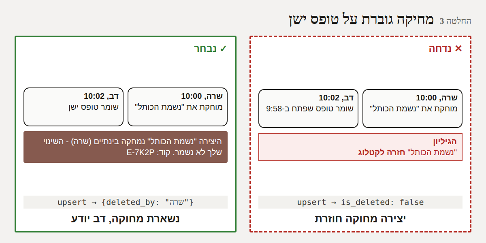
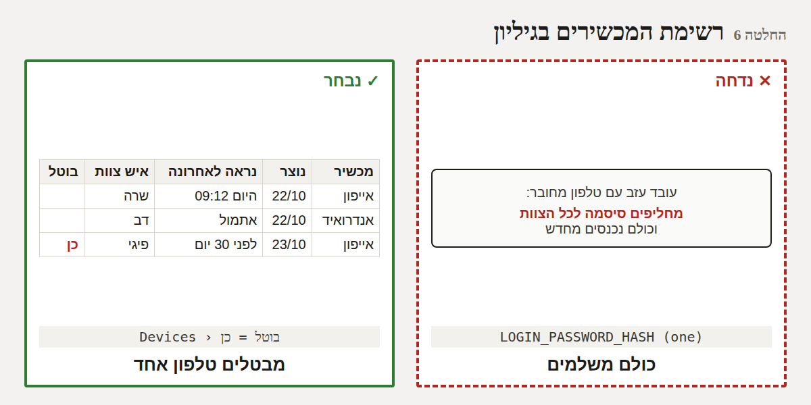
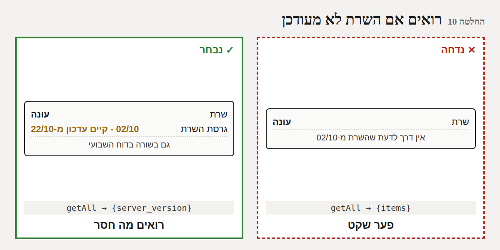
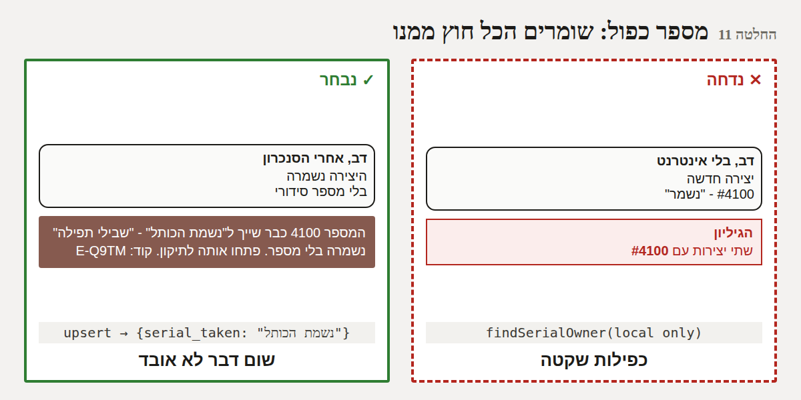

# חבילת שרת: שמירה חכמה, מפתח מכשיר, גרסת שרת, מספר סידורי בשרת - DDD

*22/10/2026. פירוט ההחלטות שאושרו בכיוון (סקירה לאחור, החלטות 1, 2, 3, 5 - "מאשר 1, 2, 3, 5, 6"). כאן -
הפרטים שעוד לא הוחלטו. שום דבר לא נבנה בלי "מאשר". כל הארבע נכנסות **בעדכון שרת אחד**.*

## 1. בשורה התחתונה

12 החלטות. שתיים שכדאי לשים לב אליהן:
- **החלטה 2:** "רק מה ששונה" חייב להיכנס **רק יחד** עם עדכון השרת. **נמדד:** אם האפליקציה הייתה שולחת "רק
  מחיר" לשרת שרץ היום - **השם והמספר הסידורי היו נמחקים**.
- **החלטה 6:** האם לרשום ליד כל טלפון את שם איש הצוות (כדי שתדע איזה טלפון לבטל) - שאלה שלך.

## 2. המומחים והוויכוח

*משתתפים: ארכיטקט הסנכרון, מומחית האבטחה, מומחה Google Workspace, מומחית חוויית המשתמש, מהנדס iOS,
מהנדס האיכות, מנהלת המוצר. תרחישים: שרה ודב עורכים את אותה יצירה; עובד עוזב עם טלפון מחובר; דב מקליד
מספר סידורי שכבר קיים, בלי אינטרנט.*

**סבב 1 - "רק מה ששונה".**
- *ארכיטקט הסנכרון:* "השרת החדש כבר שומר רק את השדות שנשלחו. נשאר שהאפליקציה תזכור **אילו שדות שונו** -
  גם אם ערכו את אותה יצירה פעמיים לפני שהיה אינטרנט."
- *מהנדס האיכות:* "בדקתי על קוד השרת שרץ היום אצל מאיר: שליחת 'רק מחיר' **מוחקת את כל השאר**. אסור לשלוח
  ככה לשרת הישן." ← האפליקציה חייבת לדעת מול איזה שרת היא עובדת.
- *מומחה Google:* "השרת כבר מודיע לאפליקציה מה הוא יודע (כמו בשם באנגלית). מוסיפים לרשימה 'שמירה חלקית'."

**סבב 2 - מחיקה מול טופס ישן.**
- *מומחית חוויית המשתמש:* "אם דב שמר טופס ישן של יצירה ששרה מחקה - הוא חייב לדעת למה השינוי שלו לא נשמר.
  הודעה ברורה, בשם מי שמחק."
- *ארכיטקט הסנכרון:* "'ביטול' אחרי מחיקה הוא שחזור מכוון - הוא צריך לעבור. רק שמירה רגילה לא מחזירה."

**סבב 3 - מפתח מכשיר.**
- *מומחית האבטחה:* "הסיסמה לא צריכה לשבת בטלפון. אחרי הכניסה - השרת נותן מפתח אקראי לטלפון הזה, ושומר
  אצלו רק 'טביעה' שלו. מפתח שנחשף - מבטלים אותו לבד."
- *מהנדס iOS:* "חשוב: טלפונים שכבר מחוברים **לא** צריכים להיכנס מחדש. בסנכרון הראשון מול השרת החדש הם
  מחליפים את הסיסמה במפתח, ומוחקים את הסיסמה מהטלפון."
- *מנהלת המוצר:* "איך מאיר מבטל טלפון? לשונית בגיליון, עמודה 'בוטל'. בלי מסך חדש באפליקציה."
- *מומחית האבטחה:* "ומה עם ניסיונות סיסמה? נעילה אחרי X ניסיונות - תנעל את **כל הצוות**, כי יש סיסמה אחת.
  עדיף: מייל למאיר אם יש הרבה ניסיונות שגויים. וקוד האיפוס - נחסם אחרי 5 טעויות."

**סבב 4 - גרסת השרת.**
- *מנהלת המוצר:* "מאיר צריך לראות 'השרת מ-02/10, יש עדכון מ-22/10' - ב'מידע ותמיכה' ובדוח השבועי."
- *מומחה Google:* "השרת לא יודע שיש גרסה חדשה יותר. האפליקציה כן - היא נבנתה עם הקוד החדש. אז האפליקציה
  משווה, ושולחת את מה שהיא מצפה לו גם עם נתוני השימוש - והדוח יכול להגיד את זה."

**סבב 5 - מספר סידורי כפול בשרת.**
- *מומחית חוויית המשתמש:* "כשהשרת מגלה כפילות, דב כבר מזמן יצא מהטופס ('נשמר מקומית'). אם השרת ידחה את
  כל השמירה - היצירה תיתקע ב'ממתינים' לנצח. עדיף: לשמור את כל השאר, **בלי** המספר, ולהגיד לו."
- *מהנדס האיכות:* "רק מספר **שהשתנה** נבדק - יצירות ישנות שכבר כפולות לא ייתקעו."

## 3. עץ ההחלטות

```
חבילת שרת
├── שמירה
│   ├── מה נשלח?        כל השורה ✕ │ רק השדות ששונו (מצטבר עד הסנכרון) ✓ (1)
│   ├── מול שרת ישן?    לשלוח חלקי ✕ (מוחק! נמדד) │ כל השורה, כמו היום ✓ (2)
│   └── טופס ישן אחרי מחיקה?  מחזיר ✕ │ נשאר מחוק + הודעה ✓ │ "ביטול" עדיין משחזר ✓ (3)
├── כניסה
│   ├── מה בטלפון?      סיסמה ✕ │ מפתח מכשיר ✓ (4)
│   ├── טלפונים מחוברים  כניסה מחדש ✕ │ מעבר אוטומטי ✓ (5)
│   ├── ביטול טלפון     החלפת סיסמה לכולם ✕ │ לשונית Devices ✓ (6) - עם שם? ← שאלה
│   ├── החלפת סיסמה     מבטלת את כל המפתחות ✓ (7)
│   ├── קוד איפוס       בלי הגבלה ✕ │ 5 טעויות ✓ (8)
│   └── כניסה שגויה      נעילה (נועלת את כולם) ✕ │ מייל אחרי 20 בשעה ✓ (9)
├── גרסת שרת           לא ידועה ✕ │ ב"מידע ותמיכה" + בדוח ✓ (10)
├── מספר סידורי בשרת   דחיית כל השמירה ✕ │ שמירה בלי המספר + הודעה ✓ (11)
└── פריסה              4 עדכונים ✕ │ עדכון שרת אחד ✓ (12)
```

## 4. הסימולציה

| תרחיש | תוצאה | איך |
|------|------|------|
| שולחים "רק מחיר" לשרת **שרץ היום** (קוד 02/10) | **השם והמספר הסידורי נמחקו** | הקוד הישן עצמו, בסימולציה |
| אותו דבר לשרת **החדש** | המחיר עודכן, השאר נשמר | קוד השרת החדש |
| שרה משנה מחיר, דב שומר הערה (שליחה חלקית) | שני השינויים נשמרים | קוד השרת החדש (סקירה לאחור) |
| מחיקה ואחריה שמירת טופס ישן | היום: היצירה **חוזרת** | קוד השרת החדש (סקירה לאחור) |
| יצירה חדשה עם מספר שכבר קיים (בשרת החדש) | היום: **שתי יצירות** עם אותו מספר | קוד השרת החדש |
| נעילה אחרי ניסיונות שגויים | סיסמה אחת לכולם ← ננעל **כל הצוות** | ניתוח (לא נמדד) |

## 5. ההחלטות

### החלטה 1 - שולחים רק את השדות ששונו
**החלטנו** שבכל שמירה האפליקציה תזכור אילו שדות שונו (גם בכמה עריכות לפני סנכרון), ותשלח לשרת רק אותם,
**כי** כך עריכה של אחד לא מוחקת שינוי של אחר בשדה אחר (הודגם). יצירה חדשה - נשלחת שלמה.

### החלטה 2 - רק מול שרת מעודכן
**החלטנו** שהשליחה החלקית תופעל רק כשהשרת מודיע שהוא יודע לקבל אותה; מול השרת הישן - נשלחת כל השורה כמו
היום, **כי** נמדד שהשרת הישן מוחק את כל השדות שלא נשלחו.

### החלטה 3 - מחיקה גוברת על טופס ישן
**החלטנו** ששמירה רגילה של יצירה שנמחקה בינתיים לא מחזירה אותה: השרת עונה "נמחקה ע"י X", והאפליקציה מסירה
אותה ומציגה הודעה עם קוד; "ביטול" אחרי מחיקה - ממשיך לשחזר, **כי** מחיקה היא החלטה מכוונת, וטופס ישן הוא
לא.


### החלטה 4 - בטלפון נשמר מפתח, לא סיסמה
**החלטנו** שאחרי כניסה השרת נותן לטלפון מפתח אקראי; הטלפון שומר רק אותו ושולח רק אותו; הסיסמה לא נשמרת,
**כי** מי שמחזיק טלפון לא אמור לדעת את סיסמת המשרד. *(את הכניסה עצמה הצוות לא מרגיש - אותו מסך.)*

### החלטה 5 - טלפונים מחוברים עוברים לבד
**החלטנו** שטלפון שכבר מחובר מחליף את הסיסמה במפתח בסנכרון הראשון מול השרת החדש, ומוחק את הסיסמה, **כי**
אסור שעדכון השרת יגרום לכל הצוות להיכנס מחדש.

### החלטה 6 - רשימת המכשירים בגיליון ⚠️ שאלה
**החלטנו** שבגיליון תהיה לשונית `Devices`: סוג המכשיר, מתי נוצר, מתי נראה לאחרונה, ועמודה "בוטל" - מאיר
כותב "כן" והטלפון מתבקש להיכנס מחדש, **כי** כך מבטלים טלפון אחד בלי להחליף סיסמה לכולם.
**השאלה:** לרשום גם **את שם איש הצוות האחרון** שעבד בטלפון? *המלצה: כן* - אחרת אי אפשר לדעת איזה טלפון
לבטל. (זה לא חלק מנתוני השימוש של סעיף 29 - זו רשימת גישה.)


### החלטה 7 - החלפת סיסמה מבטלת את כל המפתחות
**החלטנו** שהחלפת סיסמת המשרד מבטלת את כל המפתחות וכל הטלפונים נכנסים מחדש, **כי** כך זה היום, וזה מה
שמצפים מהחלפת סיסמה. שינויים שממתינים בטלפונים - נשמרים ונשלחים אחרי הכניסה (כמו היום).

### החלטה 8 - קוד איפוס: 5 טעויות
**החלטנו** שקוד האיפוס מתבטל אחרי 5 הקלדות שגויות (צריך לבקש חדש), **כי** היום אפשר לנסות בלי הגבלה.

### החלטה 9 - כניסות שגויות: מייל, לא נעילה
**החלטנו** לא לנעול את הכניסה אחרי טעויות, אבל לשלוח מייל לכתובת הדוח אם יש 20+ ניסיונות שגויים בשעה,
**כי** יש סיסמה אחת לכולם - נעילה הייתה נועלת את כל הצוות.

### החלטה 10 - רואים אם השרת לא מעודכן
**החלטנו** שהשרת מדווח את הגרסה שלו (תאריך), והאפליקציה - שיודעת מהי הגרסה האחרונה - מציגה ב"מידע ותמיכה":
"גרסת השרת: 02/10 - קיים עדכון מ-22/10", וזה מופיע גם בדוח השבועי, **כי** היום הפער שקט. לצוות - בלי באנר.


### החלטה 11 - מספר סידורי כפול: שומרים הכל חוץ ממנו
**החלטנו** שהשרת בודק מספר סידורי **שהשתנה** מול כל היצירות; אם תפוס - שומר את שאר השינויים בלי המספר,
והאפליקציה מחזירה את המספר הקודם ומציגה הודעה עם קוד: "המספר 4100 כבר שייך ל'נשמת הכותל' - 'שבילי תפילה'
נשמרה בלי מספר", **כי** דחיית כל השמירה הייתה תוקעת את היצירה ב"ממתינים", ושום דבר אחר לא צריך ללכת לאיבוד.


### החלטה 12 - עדכון שרת אחד
**החלטנו** שכל ארבע ההחלטות (1, 2, 3, 5 בסקירה) נכנסות לעדכון ה-Apps Script שכבר מתוכנן, עם מדריך מעודכן,
**כי** כל עדכון הוא עבודה ידנית שלך. **האפליקציה תעלה לאוויר לפני העדכון ותעבוד כמו היום מול השרת הישן**
(החלטה 2), ותעבור לבד ברגע שתעדכן.

## 6. מה צריך ממך

לאשר לפי מספרים ("מאשר 1-12") ולענות על השאלה בהחלטה 6 (שם איש הצוות ליד הטלפון - כן / לא).
אחרי האישור: בנייה + בדיקות (כולל השרת בסימולציה), ואז **אתה מעדכן את ה-Apps Script פעם אחת** - עדיף עד
27/10, בגלל נתוני השימוש שנשמרים 14 יום בטלפונים.
