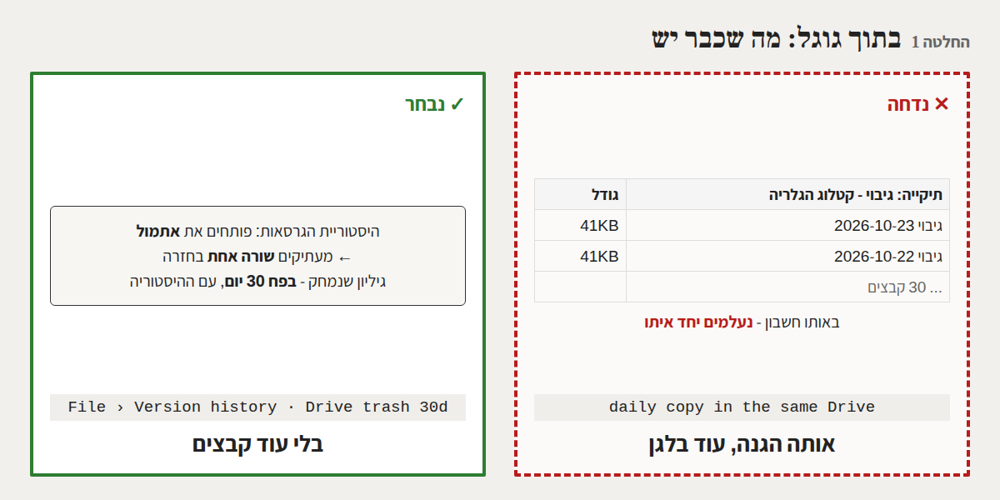
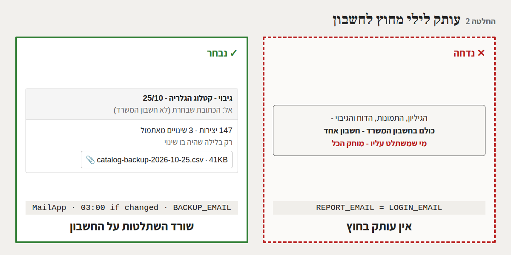
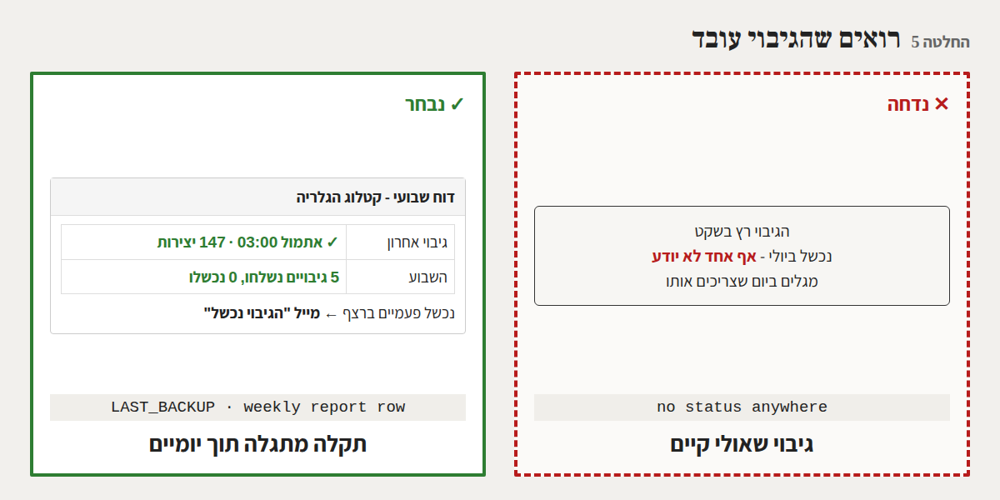
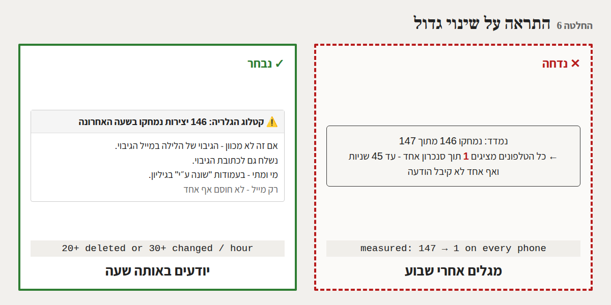
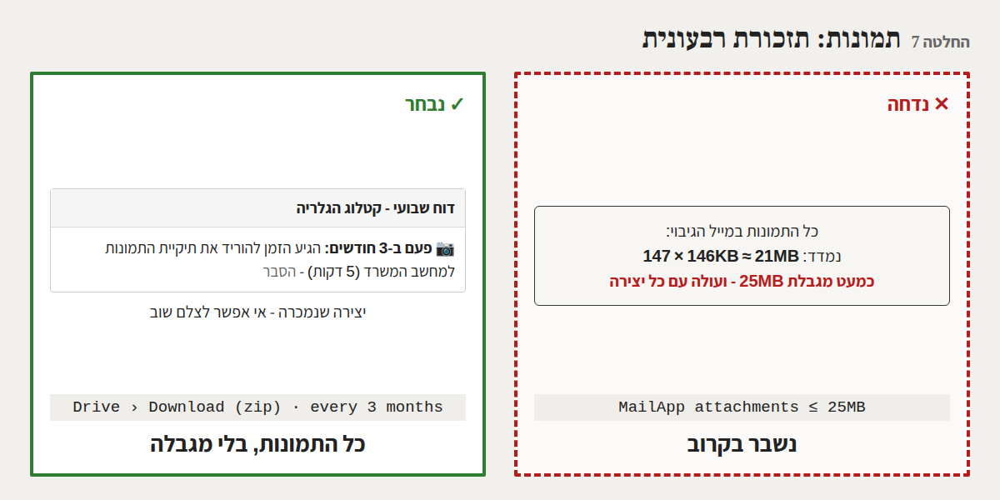

# גיבוי: עותק מחוץ לחשבון, התראה על שינוי גדול, ושחזור שנוסה - DDD

*22/10/2026. בעקבות סקירת האבטחה ("מאשר את 2 ותכין את 3"). שום דבר לא נבנה בלי "מאשר". תכונה 3 בניסיון
השיטה.*

## 1. בשורה התחתונה

10 החלטות, ושאלה אחת בשבילך: **לאיזו כתובת נשלח הגיבוי** (החלטה 3).

שלושה דברים שמצאנו בסימולציה, ולא ידענו לפני כן:
- **הגיבוי היחיד מחוץ לגוגל הוא הטלפונים, והם לא עוזרים מול השחתה.**
  - **נמדד:** כשמישהו מוחק 146 מתוך 147 יצירות, כל הטלפונים מציגים יצירה אחת תוך סנכרון אחד, כלומר עד 45
    שניות.
  - **נמדד:** אם הגיליון התרוקן לגמרי או נמחק, הטלפונים כן שומרים הכל.
- **הדוח השבועי נשלח לחשבון המשרד עצמו.** מי שמשתלט על החשבון רואה את ההתראות ומוחק אותן.
- **הקוד של האפליקציה גלוי לכולם בגיטהאב**, כך שאסור לכתוב בו את כתובת הגיבוי.

## 2. המומחים והוויכוח

*משתתפים: מומחה Google Workspace, מומחית האבטחה, ארכיטקט הסנכרון, מנהלת המוצר, מומחה המכירות, מהנדס
האיכות, מומחית חוויית המשתמש.*

*תרחישים:*
- *עובד שעזב ויודע את הסיסמה מוחק 146 יצירות ביום שישי בלילה.*
- *מישהו משתלט על חשבון הגוגל של המשרד.*
- *מאיר מוחק בטעות לשונית.*
- *יוסי צריך את המחיר שהיה לפני חודש.*

**סבב 1 - ממה בכלל מגנים?**
- *מומחית האבטחה:* "יש שלושה מקרים שונים:
  - טעות;
  - השחתה בידי מי שיודע את הסיסמה;
  - השתלטות על חשבון הגוגל.

  לשני הראשונים כבר יש תשובה בתוך גוגל. לשלישי אין כלום: הגיליון, התמונות, השרת והדוח כולם באותו חשבון."
- *מומחה Google:* "בתוך גוגל יש היסטוריית גרסאות. פותחים את הגרסה של אתמול ומעתיקים שורה אחת בחזרה, בלי
  להחזיר את כל הגיליון. גיליון שנמחק נשאר בפח 30 יום, עם ההיסטוריה שלו."
- *מנהלת המוצר:* "אז עותק יומי באותו דרייב לא מוסיף כלום. אותה הגנה, ועוד 30 קבצים. ההחלטה האמיתית היא איפה
  שמים עותק **מחוץ** לחשבון."

**סבב 2 - הטלפונים הם לא כבר גיבוי?**
- *ארכיטקט הסנכרון:* "בכל טלפון יש עותק מלא. אבל טלפון מחקה את השרת, כי זה התפקיד שלו."
  - נבדק: אם השרת מחזיר רשימה ריקה או שגיאה, הטלפון לא מוחק כלום, כי יש לזה הגנה קיימת.
  - נבדק: אם נשארה יצירה אחת, או שכל המחירים שונו ל-1, כל הטלפונים מעתיקים את זה תוך 45 שניות.
- *מהנדס האיכות:* "כלומר הטלפונים מגינים רק מפני גיליון שנעלם לגמרי. מי שמשחית בכוונה משאיר שורה אחת."
- *מומחה המכירות:* "והכי יקר זה לא השם של היצירה. זה **מה נמכר, למי ובכמה**. שבוע של מכירות שנעלם שווה כסף.
  לכן עותק שבועי לא מספיק."

**סבב 3 - איך מוציאים עותק מהחשבון?**
- *מומחה Google:* "הדרך הפשוטה היא מייל עם קובץ מצורף לכתובת אחרת. השרת כבר שולח מיילים, אז זה בלי הרשאה
  חדשה."
  - קובץ אקסל מלא היה דורש הרשאה נוספת ("גישה לשירות חיצוני").
  - קובץ CSV לא דורש הרשאה, נפתח באקסל, ונטען לגוגל שיטס.
- *מומחית האבטחה:* "שלושה תנאים:
  - הקובץ כולל רק יצירות ורשימות. לא את לשונית המכשירים, השימוש, המשוב או יומן השגיאות.
  - הכתובת לא נכתבת בקוד, כי הקוד גלוי. מגדירים אותה מתפריט בגיליון, כמו את הסיסמה.
  - תיבת המייל הזו הופכת למקום שצריך לשמור עליו, אז אימות דו-שלבי חובה."
- *מנהלת המוצר:* "מייל כל לילה זה 365 מיילים בשנה. שולחים רק בלילה שהיה בו שינוי, ובתיבת הגיבוי אפשר לסנן
  אותם לתיקייה."
  - נמדד: 41KB היום, ו-1.4MB ב-5,000 יצירות. אין בעיית גודל.

**סבב 4 - איך יודעים שזה עובד, ואיך יודעים שקרה משהו?**
- *מהנדס האיכות:* "גיבוי שנכשל בשקט מתגלה ביום שצריכים אותו.
  - הדוח השבועי צריך שורה: 'גיבוי אחרון: אתמול, 147 יצירות'.
  - אחרי שני כישלונות ברצף נשלח מייל."
- *מומחית חוויית המשתמש:* "גיבוי עוזר רק למי שיודע שצריך אותו. אם נמחקו 146 יצירות בשעה, מאיר צריך לדעת
  **באותה שעה**, לא בדוח של יום ראשון.
  - זה בדיוק כמו ההתראה על 20 סיסמאות שגויות: רק מייל, בלי לחסום אף אחד.
  - ההתראה הולכת גם לכתובת הגיבוי, כי מי שמשתלט על חשבון המשרד יכול למחוק אותה שם."
- *מנהלת המוצר:* "הסף הוא הערכה, כי לא מדדנו כמה עריכות יש בשעה עמוסה. נתחיל ב-20 מחיקות או 30 שינויים בשעה,
  ונבדוק בנתוני השימוש."

**סבב 5 - תמונות ושחזור**
- *מומחה Google:* "תמונות לא נכנסות למייל.
  - נמדד על עמודי הקטלוג: 146KB בממוצע לתמונה ברוחב 1600. כפול 147 יצירות זה כ-21MB.
  - מגבלת הקבצים המצורפים היא 25MB. תמונה מטלפון כנראה גדולה יותר, כך שזו הערכה של 250-500KB לתמונה."
- *מומחה המכירות:* "יצירה שנמכרה אי אפשר לצלם שוב. ההצעה: פעם בשלושה חודשים מורידים את תיקיית התמונות למחשב
  המשרד. זה חמש דקות, עם תזכורת בדוח."
- *מהנדס האיכות:* "גיבוי שאף אחד לא שחזר ממנו הוא תקווה. צריך מדריך שחזור בעברית פשוטה, וניסיון אחד של מאיר."

## 3. עץ ההחלטות

```
גיבוי
├── בתוך גוגל        עותק יומי בדרייב ✕ (אותו חשבון) │ היסטוריית גרסאות + פח 30 יום ✓ (1)
├── מחוץ לחשבון      כלום ✕ │ טלפונים ✕ (נמדד: מעתיקים השחתה) │ מייל עם קובץ ✓ (2)
│   ├── מתי?         שבועי ✕ (שבוע מכירות) │ כל לילה ✕ (365 מיילים) │ לילה שהיה בו שינוי ✓ (2)
│   ├── לאן?         כתובת בקוד ✕ (הקוד גלוי) │ מתפריט בגיליון ✓ (3) ← שאלה: איזו כתובת
│   └── מה?          כל הקובץ ✕ (מכשירים, שימוש) │ אקסל ✕ (הרשאה חדשה) │ CSV יצירות + רשימות ✓ (4)
├── שקיפות           בשקט ✕ │ שורה בדוח + מייל אחרי 2 כישלונות ✓ (5)
├── זיהוי השחתה      דוח שבועי ✕ │ חסימה ✕ (תוקעת עבודה) │ מייל באותה שעה, לשתי הכתובות ✓ (6) ⚠️ חדש
├── תמונות           במייל ✕ (נמדד: ~21MB) │ הורדה רבעונית + תזכורת ✓ (7)
├── שחזור            "נסתדר" ✕ │ מדריך + ניסיון אחד ✓ (8)
├── טלפונים          חסימת מחיקה גדולה ✕ │ בלי שינוי ✓ (9)
└── פריסה            עדכון נפרד ✕ │ באותו עדכון שרת, אם יאושר בזמן ✓ (10)
```

## 4. הסימולציה

| תרחיש | תוצאה | איך |
|------|------|------|
| לאן נשלח הדוח השבועי היום | לחשבון המשרד עצמו (`REPORT_EMAIL = LOGIN_EMAIL`) | קריאת Code.gs |
| הקוד בגיטהאב | **גלוי לכולם** - כתובת שתיכתב בו תהיה ציבורית | GitHub |
| הגיליון התרוקן לגמרי | הטלפון שומר **147 מתוך 147** | האפליקציה האמיתית, שרת מדומה |
| הגיליון נמחק (השרת מחזיר שגיאה) | הטלפון שומר **147 מתוך 147** | האפליקציה האמיתית |
| נמחקו 146, נשארה אחת | הטלפון מציג **1** אחרי סנכרון אחד (עד 45 שניות) | האפליקציה האמיתית |
| כל המחירים שונו ל-1 | הטלפון מציג **1** אחרי סנכרון אחד | האפליקציה האמיתית |
| גודל קובץ הגיבוי (CSV) | 41KB (147 יצירות), 279KB (1,000), 1.4MB (5,000) | נמדד, שדות במבנה האמיתי |
| תמונה ברוחב 1600 | 146KB בממוצע (13 עמודים מהקטלוג), כלומר כ-21MB ל-147 יצירות | נמדד על הקטלוג |
| תמונה מטלפון | 250-500KB, כלומר 37-74MB | **הערכה** |
| מגבלת קובץ מצורף במייל | 25MB | **מגוגל, לא נמדד** |
| זמן הכנת הגיבוי בשרת | פחות מ-10 שניות ל-147 יצירות (המגבלה של גוגל: 6 דקות) | **הערכה** |
| עריכות בשעה עמוסה | לא ידוע. הסף 20/30 הוא נקודת התחלה | **הערכה**, ייבדק בנתוני השימוש |

## 5. ההחלטות

### החלטה 1 - בתוך גוגל: מה שכבר יש
**החלטנו** לא להוסיף עותקים בתוך הדרייב, ולהסתמך על היסטוריית הגרסאות של הגיליון ועל הפח (30 יום), **כי**:
- היסטוריית הגרסאות כבר מאפשרת להחזיר יצירה אחת מאתמול;
- עותק באותו חשבון נעלם יחד איתו.


### החלטה 2 - עותק לילי מחוץ לחשבון
**החלטנו** שבכל לילה שהיה בו שינוי, ב-03:00, השרת ישלח מייל "גיבוי - קטלוג הגלריה - <תאריך>" לכתובת שאינה
חשבון המשרד, עם קובץ מצורף. **כי**:
- זה הדבר היחיד ששורד השתלטות על החשבון;
- הטלפונים לא עוזרים מול השחתה (נמדד);
- שבוע של מכירות שנעלם יקר מדי.


### החלטה 3 - הכתובת נקבעת בגיליון, לא בקוד ⚠️ שאלה
**החלטנו** שאת כתובת הגיבוי מגדירים מתפריט "קטלוג הגלריה" בגיליון ("כתובת לגיבוי"), כמו את הסיסמה, **כי**
הקוד גלוי לכולם בגיטהאב.

**השאלה:** לאיזו כתובת לשלוח?
- *המלצה:* כתובת פרטית שלך או של יוסי, שאינה בחשבון של yossibittonart.com, עם אימות דו-שלבי.
- אפשר גם שתי כתובות.

### החלטה 4 - מה בקובץ
**החלטנו** שהקובץ יהיה CSV שנפתח באקסל עם עברית תקינה. **מה בפנים:**
- כל היצירות, כולל אלה שנמחקו, עם סימון;
- הרשימות (סוגים, מיקומים).

**מה לא בפנים:** לשונית המכשירים, השימוש, המשוב ויומן השגיאות.

**כי:**
- CSV לא דורש הרשאה חדשה (אקסל מלא כן דורש);
- הוא נטען חזרה לגוגל שיטס;
- כל השאר לא נחוץ לשחזור, וחלקו רגיש.

*(בלי שינוי שרואים באפליקציה.)*

### החלטה 5 - רואים שהגיבוי עובד
**החלטנו** שבדוח השבועי תהיה שורה "גיבוי אחרון: אתמול 03:00, 147 יצירות; השבוע: 5 נשלחו, 0 נכשלו". אם הגיבוי
נכשל שני לילות ברצף, נשלח מייל "הגיבוי נכשל" עם הסיבה. **כי** גיבוי שנכשל בשקט מתגלה רק ביום שצריכים אותו.


### החלטה 6 - התראה על שינוי גדול ⚠️ חדש
**החלטנו** שאם בשעה אחת נמחקו 20 יצירות או יותר, או שונו 30 או יותר, נשלח מייל:
"⚠️ קטלוג הגלריה: 146 יצירות נמחקו בשעה האחרונה".
- **מה במייל:** מספר ושעה, והפניה לגיבוי של הלילה.
- **מה לא במייל:** שמות. מי עשה מה כבר רשום בגיליון.
- **לאן:** לכתובת הדוח וגם לכתובת הגיבוי.
- **בלי לחסום** אף אחד.

**כי:**
- נמדד שהטלפונים מעתיקים השחתה תוך 45 שניות;
- היסטוריית הגרסאות עוזרת רק אם מישהו שם לב.

*הסף הוא הערכה, וייבדק בנתוני השימוש.*


### החלטה 7 - תמונות: תזכורת כל שלושה חודשים
**החלטנו** שהתמונות לא נכנסות לגיבוי האוטומטי. במקום זה, פעם בשלושה חודשים הדוח השבועי מזכיר להוריד את תיקיית
התמונות מהדרייב למחשב המשרד (בערך חמש דקות). **כי**:
- נמדד: כ-21MB כבר היום, קרוב למגבלת 25MB, וזה עולה עם כל יצירה;
- יצירה שנמכרה אי אפשר לצלם שוב.


### החלטה 8 - מדריך שחזור וניסיון אחד
**החלטנו** לכתוב את `docs/RESTORE.md` בעברית פשוטה, לשלושה מקרים:
1. יצירה אחת;
2. יום שהשתבש;
3. החשבון אבד.

ואתה תנסה פעם אחת לשחזר יצירה מקובץ הגיבוי, ברשימה שלך. **כי** גיבוי שאף אחד לא שחזר ממנו הוא רק תקווה.

### החלטה 9 - הטלפונים: בלי שינוי
**החלטנו** לא לשנות את הטלפונים, **כי**:
- נמדד שהם כבר לא נמחקים כשהגיליון ריק או חסר. אם הכל נעלם, טלפון כזה יכול "לייצא לאקסל" כעותק חירום.
- חסימה של מחיקה גדולה בכל טלפון הייתה מסבכת כל טלפון, בשביל מקרה שהחלטות 2 ו-6 כבר מכסות.

### החלטה 10 - באותו עדכון שרת
**החלטנו** שאם תאשר לפני שתעדכן את ה-Apps Script, הגיבוי ייכנס לאותו עדכון, יחד עם "installTriggers" שכבר
ברשימה שלך. אחרת זה יהיה עדכון נפרד. **כי** כל עדכון הוא עבודה ידנית שלך.

## 6. מה צריך ממך

1. **לאשר לפי מספרים** ("מאשר 1-10").
2. **לענות על השאלה בהחלטה 3:** לאיזו כתובת נשלח הגיבוי.

אחרי האישור: בנייה ובדיקות (כולל השרת בסימולציה), ואז עדכון ה-Apps Script. אם תאשר בזמן, זה העדכון שכבר מתוכנן,
ואז מגדירים את הכתובת מהתפריט בגיליון.
